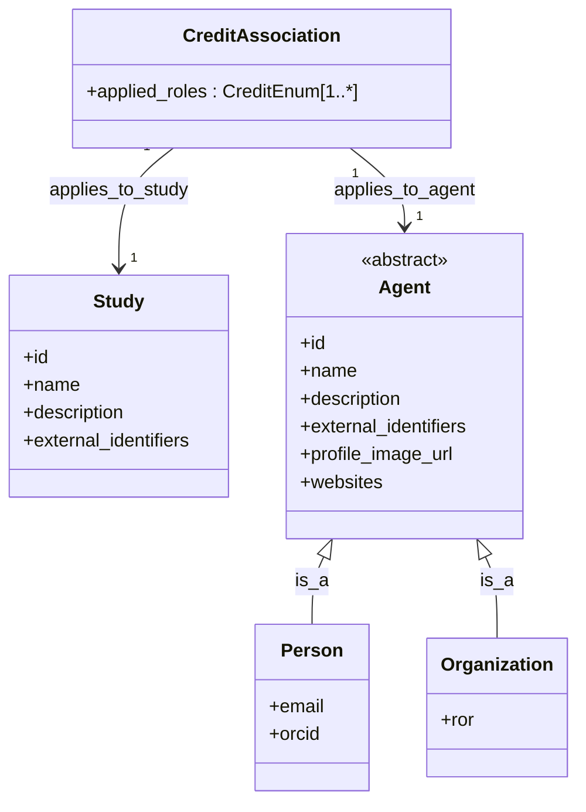
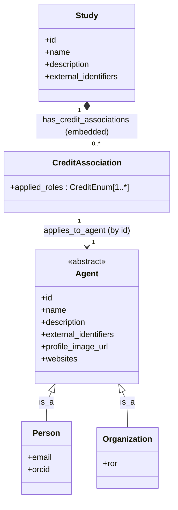

# Study/Person/Credit Modeling: Relational vs. Document LinkML Style Example
### BJM + Claude 30 Oct 2026

Two ways of modeling how a `Study` is linked to the `Agent`s (`Person`/`Organization`)
credited on it, via `CreditAssociation`.

## Relational Approach
`bridge-central-schema/src/ber_central_schema/schema/umbrella.yaml`

`CreditAssociation` is a standalone, independently-queryable class — a pure join
table. It holds two foreign keys, `applies_to_study` and `applies_to_agent`, and
isn't owned by either side. Looking up "who's on this study" or "what studies is
this person on" are symmetric queries against the same table.

## Document Approach
`bridge-central-schema/src/ber_central_schema/schema/umbrella_alt.yaml`

`CreditAssociation` is embedded (`*--`, `inlined_as_list`) directly inside
`Study.has_credit_associations`. It has no identity outside its parent `Study`
document, and no `applies_to_study` field.
It keeps only one reference arrow outward, `applies_to_agent` -> `Agent`, by id
rather than an embedded copy. That's a deliberate divergence from nmdc-schema's
own fully-embedded `Agent`, done here to keep `Person`/`Organization`
de-duplicated.

## Under the Hood: Document on a Relational Store

The document approach is a logical/serialization shape, not a storage mandate.
On a relational database, `Study.has_credit_associations` can't physically live
as a nested array inside the `Study` row because SQL has no native embedded-list
column. We would use LinkML translator tools to flatten it back into its own 
table: a `credit_association` table with a `study_id` foreign key 
(reconstructing the very `applies_to_study` column the document model dropped 
at the schema level) plus the existing `agent_id` foreign key.

So on a relational engine, the two approaches converge to nearly the same
physical tables. The real difference becomes an application/API-layer
concern — whether client code reads and writes credit associations as a
nested array on the `Study` object (a document-shaped API over a relational
store) or as a separately addressable resource (a relational-shaped API) —
not a difference in what's stored on disk.

This is a small example with minor differences in human readability for us as
the LinkML developers. More complex relationships (i.e. `SampleProcessing` 
chains in BASALT) may be harder to read as relational-style LinkML. On the
other hand, writing LinkML classes the way they are actually going to be held
in the database may be valuable for developer understanding.
